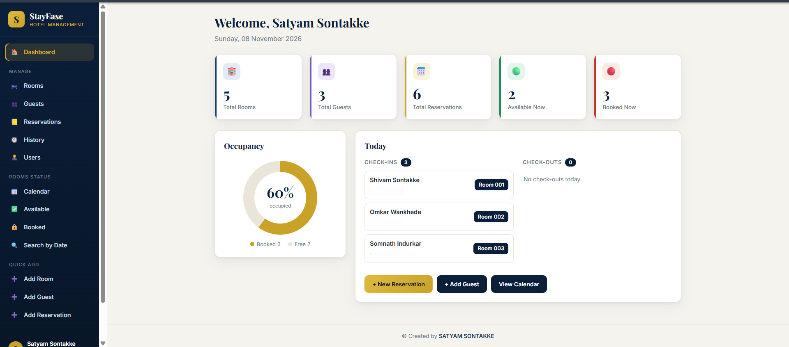
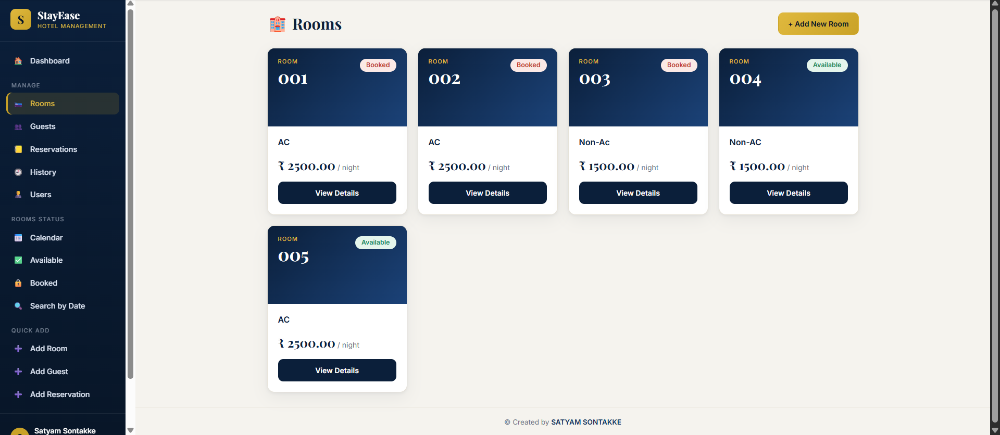
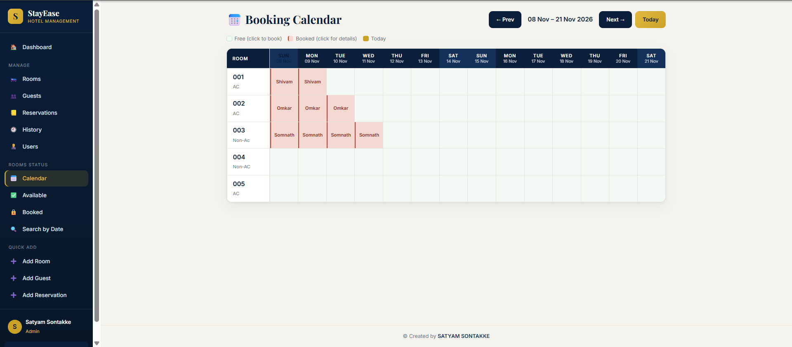
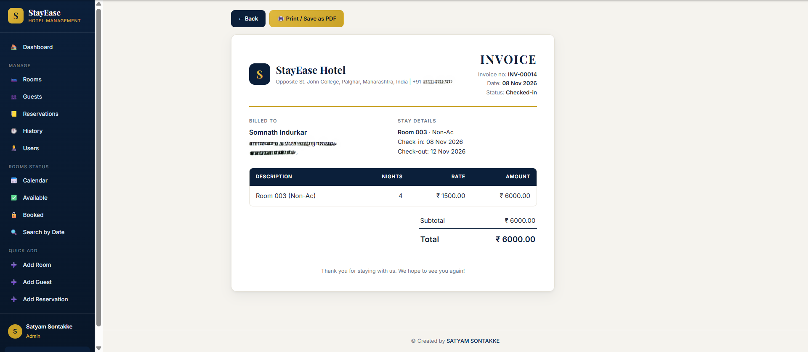

# StayEase – Hotel Booking Management System

A Django web app to manage hotel rooms, guests and reservations, with separate
access for **Admin**, **Staff** and **Customer** roles.

**Live demo:** https://satyamsontakke.pythonanywhere.com

> The live demo uses sample data. To try the Customer view, register a new account on the site.

## Features

- **Roles:** Admin, Staff and Customer, each with their own menu and permissions
- **Rooms:** add and edit rooms with type, price and image (Admin only)
- **Guests:** add, search, edit and delete guests (guests with bookings are protected)
- **Reservations:** create and edit bookings with automatic double-booking prevention
- **Status flow:** Confirmed → Checked-in → Checked-out, plus Cancel
- **Invoice:** printable invoice for every booking
- **Calendar:** 14-day room availability grid
- **Room status pages:** available rooms, booked rooms and search by date
- **Users page:** Admin can see all registered users and change their roles
- **Customer portal:** customers register, book rooms, and see only their own bookings

## Roles

| Feature | Admin | Staff | Customer |
|---|---|---|---|
| Add / edit rooms | Yes | No | No |
| Manage guests | Yes | Yes | No |
| Create reservations | Yes | Yes | Yes (own) |
| Check-in / check-out | Yes | Yes | No |
| Delete reservations | Yes | No | No |
| Users page and role change | Yes | No | No |
| View invoice | Yes | Yes | Own bookings |

## Tech stack

- Python and Django
- SQLite
- Pillow (room images)
- HTML, CSS (custom Navy + Gold design) and a little vanilla JavaScript (mobile sidebar menu)

## Setup

```bash
git clone https://github.com/satyamsontakke/stayease-hotel-management.git
cd stayease-hotel-management
pip install -r requirements.txt
python manage.py migrate
python manage.py createsuperuser
python manage.py runserver
```

Then open http://127.0.0.1:8000

## Environment variables (optional)

| Variable | Purpose |
|---|---|
| `DJANGO_SECRET_KEY` | Secret key (set this in production) |
| `DJANGO_DEBUG` | `True` or `False` |
| `DJANGO_ALLOWED_HOSTS` | Comma-separated hosts |

## Screenshots






## Author

Satyam Sontakke